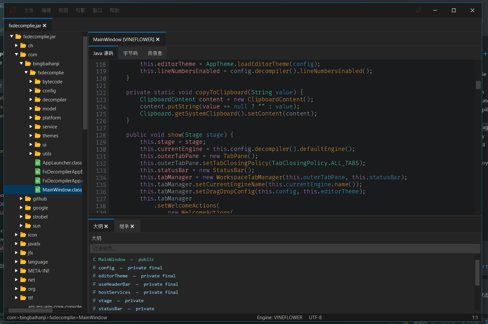

# FxDecompiler

基于 JDK 25 / JavaFX 25 的 Java 字节码反编译桌面工具。支持打开 JAR、ZIP、目录和单个 class 文件，提供多引擎反编译、字节码视图、全局搜索、用法查找、继承分析、代码导出等能力。

## 功能

- **多引擎反编译** — Vineflower / CFR / Procyon / JD-Core / JADX / bdec，一键切换，支持引擎级自定义选项（默认引擎为 JADX）
- **工作区管理** — 打开 JAR、ZIP、目录、class 文件，按包树浏览，多工作区标签页
- **代码编辑器** — 语法高亮（VS Code 主题）、行号、代码折叠、Ctrl+Click 导航跳转
- **字节码视图** — javap 风格字节码/汇编展示，与源码视图并列
- **类信息面板** — 访问标志、常量池统计、方法/字段列表
- **全局搜索** — 类名、成员、方法签名、源码全文、注释、资源文件、字节码文本，7 种搜索模式
- **Find Usages** — 基于 ASM 的类引用和方法调用分析
- **继承引用** — 父类、接口、注解、实现类、子类及方法重写关系的树状展示，双击跳转
- **结构大纲** — 字段/方法/内部类实时列表，点击跳转
- **导出** — 反编译源码导出为目录或 ZIP，支持冲突策略（覆盖/跳过/重命名）
- **多窗口** — 代码标签页可拖拽到独立窗口，跨窗口拖回
- **MCP 服务** — 可在设置中启用 Streamable HTTP / 旧版 HTTP+SSE 服务，复制客户端 JSON，让 Claude Code / Cursor 等 agent 查询、反编译、对比、搜索和导出
- **配置持久化** — 窗口状态、引擎偏好、主题、最近文件自动保存
- **三级缓存** — L2 内存缓存 + L3 磁盘持久化缓存 + 实际反编译流水线，避免重复反编译
- **国际化** — 简体中文 / English 动态切换
- **暗色主题** — 内置 VS Code 暗色主题，支持外部主题 JSON

## 环境要求

- **JDK 25**；JavaFX 25.0.1 由 Maven 依赖提供
- Maven 3.9+（或使用项目内置 `mvnw`）
- 操作系统：Windows / Linux / macOS

## 快速开始

```bash
# 克隆仓库
git clone https://github.com/bingbaihanji/fxdecomplie.git
cd fxdecomplie

# 编译
./mvnw clean compile -DskipTests

# 运行
./mvnw exec:java

# 打包 fat JAR（输出到 bin/fxdecomplie.jar）
./mvnw clean package -DskipTests

# 运行测试
./mvnw test
```

Windows PowerShell 用户请使用 `.\mvnw.cmd` 替代 `./mvnw`。

### 命令行参数

```bash
# 启动时自动打开指定文件
./mvnw exec:java -Dexec.args="--open /path/to/app.jar"
```

fat JAR 打包后直接运行：

```bash
java -jar bin/fxdecomplie.jar --open /path/to/app.jar
```

## 技术栈

| 类别 | 技术 |
|------|------|
| 语言 / 运行时 | Java 25 + JavaFX 25.0.1 |
| 代码编辑器 | jfx.incubator.richtext CodeArea |
| 反编译引擎 | Vineflower 1.12.0 / CFR 0.152 / Procyon 0.6.0 / JD-Core 1.1.3 / JADX（自维护内核）/ bdec 1.0.0 |
| 字节码分析 | ASM 9.9 |
| 类扫描（vendored） | ClassGraph 4.8.184（`com.bingbaihanji.classgraph`） |
| 缓存 | 自定义 L2/L3 缓存 |
| JSON | Jackson 2.22.4 |
| MCP | MCP Java SDK 2.2.0 + Jetty 12.1.15 EE11 |
| 日志 | SLF4J 2.0.17 + Logback 1.5.18 |
| 原生窗口 | JNA 5.17.0（Windows DWM 边框/圆角/标题栏） |
| 测试 | JUnit Jupiter 5.12.1 |
| 构建 | Maven + Shade Plugin 3.6.0（fat JAR） |

## 项目结构

```
src/main/java/
├── com/bingbaihanji/fxdecomplie/
│   ├── AppLauncher.java / FxDecompilerApp.java
│   ├── app/           # ApplicationServices：缓存与任务服务装配
│   ├── bytecode/      # 字节码签名/元数据解析
│   ├── config/        # 应用配置 POJO 与 JSON 持久化
│   ├── constants/     # 应用目录与启动路径
│   ├── context/       # AppContext 全局生命周期
│   ├── controller/    # 主窗口、工作区、导航、编辑器动作
│   ├── core/jadx/     # vendored JADX 反编译内核
│   ├── decompiler/    # 引擎接口、6 个实现、工厂与上下文
│   │   └── jadx/      # JADX 适配层（输入/参数/输出/重命名/诊断）
│   ├── mcp/           # MCP 入站适配层（Jetty、鉴权、工具、异步任务）
│   ├── model/         # 工作区、文件树、索引、导出与导航模型
│   │   └── reference/ # 继承引用视图模型
│   ├── rename/        # 项目级持久化重命名服务
│   ├── service/       # 发现、索引、反编译、搜索、导出、导航
│   │   ├── cache/     # CacheManager / CacheKeys / SourceSnapshotCache
│   │   ├── classscan/ # ClassGraph 扫描适配（ClassScanService）
│   │   ├── decompile/ # L2/L3 缓存协调（DecompileCacheService）
│   │   ├── reference/ # 继承引用索引与查询
│   │   ├── task/      # TaskExecutorService / ThreadPoolTaskExecutor
│   │   └── workspace/ # 工作区字节码提供器与会话注册表
│   ├── ui/            # JavaFX 界面
│   │   ├── code/      #   代码编辑器标签页、状态栏、独立窗口
│   │   ├── inheritance/ # 继承引用面板
│   │   ├── outline/   #   结构大纲面板
│   │   ├── quickopen/ #   快速打开对话框
│   │   ├── search/    #   7 种搜索提供器 + 搜索对话框
│   │   ├── theme/     #   主题系统（VS Code 主题加载、正则高亮）
│   │   ├── tree/      #   文件树视图
│   │   ├── uml/       #   UML 类图
│   │   └── usage/     #   Find Usages 对话框
│   └── util/          # 国际化、ASM、缓存、导航等工具类
├── com/bingbaihanji/classgraph/ # vendored ClassGraph 4.8.184（MIT）
├── com/bingbaihanji/bdec/      # vendored bdec 内核
├── com/bingbaihanji/utils/     # JSONUtils 等共享工具
└── com/bingbaihanji/windows/   # Windows 原生窗口外观（JNA）
```



## 架构亮点

### 线程模型

耗时操作按任务类型分流，而不是共用单一线程池：文件发现、索引、搜索、缓存写入等通过 `BackgroundTasks` 的 INTERACTIVE / IO / INDEX / EXPORT 池执行；反编译由 `DecompilerRunner` 的独立固定线程池（`max(2, min(核数/2, 8))`）执行；导出流水线另建有序有界线程池；索引构建使用独立的单线程 INDEX 池，并以虚拟线程并行处理节点。UI 更新通过 `Platform.runLater()` 回到 JavaFX Application Thread。切换类文件时先取消当前反编译任务再提交新任务，避免过期结果覆盖。

### 三级缓存

反编译结果走 `L2 内存缓存 → L3 磁盘缓存 → 实际反编译` 三级流水线。缓存键由 workspaceId（绝对路径 + 内容戳）、类文件 SHA-256 指纹（前 16 位十六进制）、内部名、引擎、选项 hash 和 key version 组成。L3 写入为异步、尽力而为；超时、失败、取消的结果不会进入缓存。class 字节码按需从文件树或归档懒加载，不在打开 JAR 时全量预加载；工作区索引另有独立的 GZIP 持久化缓存（`cache/index/v1`，200 MB 配额）。

### 搜索系统

`SearchService` 聚合 7 个独立 `SearchProvider`，支持 200ms 防抖输入、组合框过滤、大小写/正则/全词匹配选项、排除路径模式、结果上限配置。

### MCP 服务

设置页可启用 MCP 服务：默认只绑定 `127.0.0.1`，可切换局域网地址；强制 Bearer Token，支持 Streamable HTTP（`/mcp`）和旧版 HTTP+SSE（`/sse`+`/message`）。`mcp/` 层只依赖 service/model/config/decompiler/util/rename，不直接操作 JavaFX；AI 打开的工作区通过 `WorkspaceSessionRegistry` 同步到 GUI 标签页。工具覆盖工作区、类信息/源码/字节码/资源、继承、用法、搜索，以及异步的引擎对比、反混淆建议和导出；导出工具需在设置页单独启用。

### Ctrl+Click 导航

反编译后自动从源码提取类引用映射（`CodeMetadata`），Ctrl+Click 时通过 `findNodeByPath()` 在文件树中查找目标类并递归打开。

## 配置与数据

打包运行后应用数据默认写入 JAR 所在目录：

```
<appDir>/
├── config/config.json    # 窗口/主题/引擎/导出/搜索/平台/MCP 偏好
├── cache/
│   ├── decompile/v1/     # L3 磁盘反编译缓存
│   ├── index/v1/         # 工作区索引缓存（GZIP）
│   ├── jadx/runtime/     # JADX 运行期临时目录（不参与缓存清理）
│   ├── tmp/              # 统一临时目录
│   └── javafx/           # JavaFX / Prism 缓存
├── logs/                 # application.log / error.log / startup-error.log
├── fxdecomplie/
│   ├── comments/         # 注释持久化
│   └── renames/          # 重命名映射
└── themes/               # 外部主题 JSON
```

开发期 classpath 位于 `target/classes/` 时回退到项目根目录，避免 `mvn clean` 删除配置；其他开发场景回退到 `user.dir`。

## 国际化

支持简体中文和英文动态切换。语言文件优先级：

1. JAR 同级目录 `language/` 文件夹（外部文件，方便用户自定义）
2. classpath `resources/language/`（内置默认）

当前中英文语言包各 619 个 key，覆盖全部 UI 文本。

## 维护约定

- JavaFX 线程只做 UI 更新，耗时操作一律放入 `BackgroundTasks`
- class 字节懒加载，避免打开大型 JAR 时一次性占用大量内存
- 新增 UI 文本需同步更新 `language_zh_CN.properties` 和 `language_en.properties`
- 新增功能优先补 JUnit 5 单元测试，涉及索引/搜索/导出/项目文件解析的变更必须覆盖异常路径
- `bin/`、`target/`、运行日志和构建副产物不应提交到仓库

## License

MIT License

Copyright (c) 2026 冰白寒祭

Permission is hereby granted, free of charge, to any person obtaining a copy
of this software and associated documentation files (the "Software"), to deal
in the Software without restriction, including without limitation the rights
to use, copy, modify, merge, publish, distribute, sublicense, and/or sell
copies of the Software, and to permit persons to whom the Software is
furnished to do so, subject to the following conditions:

The above copyright notice and this permission notice shall be included in all
copies or substantial portions of the Software.

THE SOFTWARE IS PROVIDED "AS IS", WITHOUT WARRANTY OF ANY KIND, EXPRESS OR
IMPLIED, INCLUDING BUT NOT LIMITED TO THE WARRANTIES OF MERCHANTABILITY,
FITNESS FOR A PARTICULAR PURPOSE AND NONINFRINGEMENT. IN NO EVENT SHALL THE
AUTHORS OR COPYRIGHT HOLDERS BE LIABLE FOR ANY CLAIM, DAMAGES OR OTHER
LIABILITY, WHETHER IN AN ACTION OF CONTRACT, TORT OR OTHERWISE, ARISING FROM,
OUT OF OR IN CONNECTION WITH THE SOFTWARE OR THE USE OR OTHER DEALINGS IN THE
SOFTWARE.
